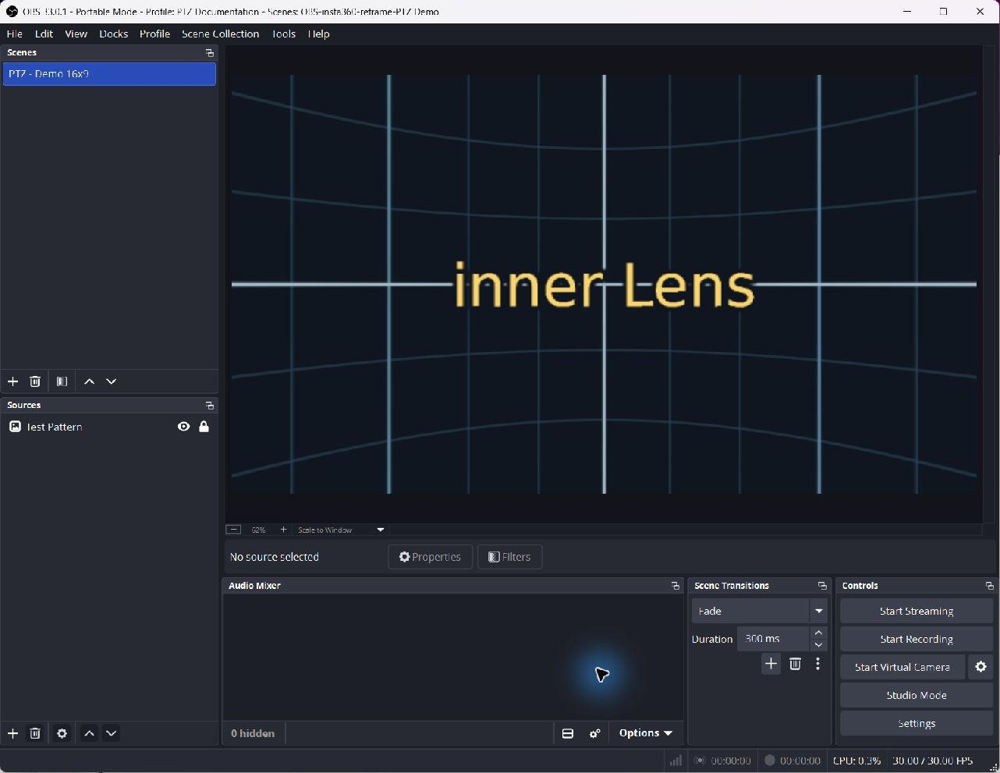

# OBS-insta360-reframe-PTZ

A perspective virtual PTZ camera for a stitched 360° equirectangular image in OBS Studio. Use an Insta360 X4 or X5 webcam feed at **2880×1440** (full 360° output) or the included test pattern, then control pan, tilt, roll and horizontal field of view from a local OBS browser dock.

## Features

- Perspective 16:9 output with pan ±180°, tilt ±90°, roll ±180° and horizontal FOV 10–150°.
- Mouse control is **locked by default**. Enable it explicitly for grab-and-drag and wheel zoom.
- Up to 100 named preset slots, smooth moves, individual clear/delete and JSON import/export.
- Home view: choose the inner/display-side lens or the opposite outer lens and its FOV.
- Compact preset bar with automatic horizontal/vertical layout, Expand and Stop.
- English, German and Spanish dock translations.
- An image-only example collection: no camera is required to verify the projection.

## Requirements and tested scope

The demonstrated setup uses **Windows, OBS Studio 33.0.1 and obs-shaderfilter 2.6.1**. The dock uses OBS WebSocket v5, included in current OBS Studio. Move is optional and is not required for dock presets or animation. Other operating systems, OBS versions and cameras have not been validated for this release.

The input must be a **stitched, full-sphere 360×180° equirectangular panorama**, normally 2:1. Raw dual-fisheye, an already reframed webcam view or a cropped panorama cannot be corrected by this shader. Resolution alone does not establish the projection.

## Quick start: test pattern

1. Download/extract the whole repository to a permanent local directory. Keep its folders together.
2. Install [OBS Studio](https://obsproject.com/) and [obs-shaderfilter](https://github.com/exeldro/obs-shaderfilter/releases), then restart OBS.
3. Set **Settings → Video → Base (Canvas) Resolution** to **1920×1080**. Output may be 1920×1080 or, as demonstrated, 1280×720. See [OBS setup](docs/obs-setup.md).
4. Prepare and import the [example scene collection](docs/scene-import.md), or follow the [manual setup](docs/obs-setup.md).
5. At pan **0°**, check the centered **inner Lens** label. At pan **180°** (equivalent to −180°), check **outer Lens**.
6. Add the local [PTZ browser dock](docs/dock-setup.md), enable authenticated OBS WebSocket and connect.

The example target names are **PTZ - Demo 16x9** and **PTZ - Perspective 16x9**. The shader belongs to the **scene**, not the image/camera source, in this documented workflow.

## Documentation

| Guide | Purpose |
| --- | --- |
| [Installation](docs/installation.md) | Dependencies, files and supported input |
| [OBS setup](docs/obs-setup.md) | Canvas, image/camera transform and shader settings |
| [Scene import](docs/scene-import.md) | Sanitized collection, local paths and import steps |
| [Dock setup](docs/dock-setup.md) | Local dock URL, WebSocket and translations |
| [Usage](docs/usage.md) | Mouse control, home view, presets and compact mode |
| [Troubleshooting](docs/troubleshooting.md) | Missing labels, distortion and connection errors |
| [Projection](docs/projection.md) | Geometry, coordinate conventions and processing order |
| [Validation](docs/validation.md) | Checks performed and their limits |
| [Credits](CREDITS.md) | Dependencies and asset provenance |

## Repository layout

`shaders/` contains the shader.
`dock/` contains the complete local browser UI and its three language files.
`example/` contains the 2880×1440 pattern, neutral presets and sanitized scene collection template. `docs/screenshots/` contains captures from a separate English OBS instance.
`tools/` contains an optional Windows path-preparation helper.
`tests/` contains dependency-free Node.js checks.

## Limitations

The dock controls its explicitly named target scene even when another scene is on Program. It does not start streaming, recording or the virtual camera. Its preview is a periodically fetched still image, not a second full-frame-rate video output. Compact mode pauses those requests. Expand changes the content; **OBS still controls the dock's outer size**. Automatic native window resizing is not implemented.

This project is not an official Insta360 or OBS product. Original project code and documentation are provided under the [MIT license](LICENSE); third-party software remains under its own license. No OBS/plugin binaries, device identifiers, passwords or personal preset exports are included.

## AI disclaimer

Large parts of the code were created with the assistance of ChatGPT 6.1-Sol. The project idea, design, direction and initial code were provided by a human, who also tested the project using real video footage.
