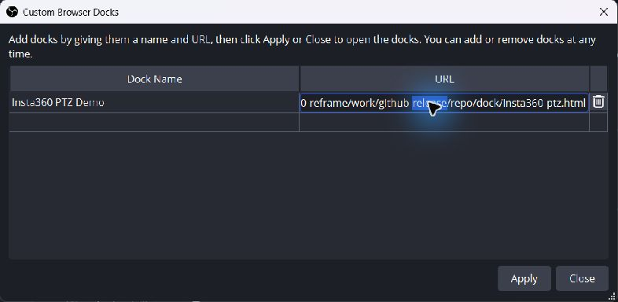
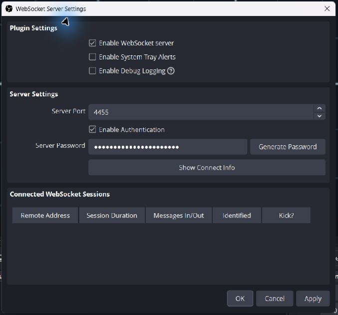
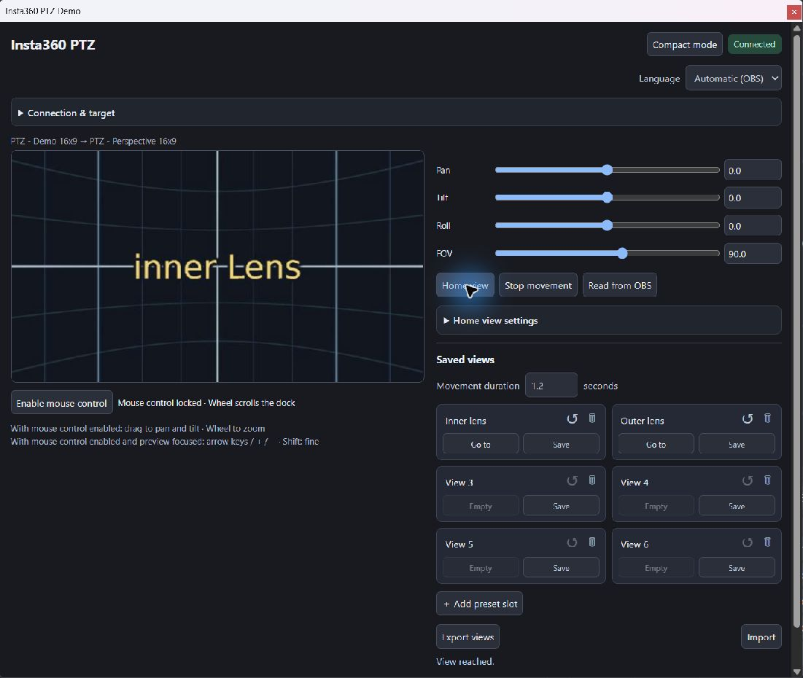

# Set up the PTZ dock

## Local browser dock

In **Docks → Custom Browser Docks**, add a dock named **Insta360 PTZ**. Its URL must point to your local `dock/insta360-ptz.html`, for example:

```text
file:///C:/OBS-PTZ/dock/insta360-ptz.html
```

Use your actual path. A path containing spaces is represented as `%20` in a file URL. The optional preparation script prints the correct URL. Keep the HTML, JavaScript and `locales/` directory together. Click Apply/Close, then show the dock from the Docks menu if needed.



## OBS WebSocket

Open **Tools → WebSocket Server Settings**. Enable the server and leave authentication enabled. The usual port is **4455**. Copy/read your own password locally and enter it directly into the dock; do not put it in a README, screenshot, URL or preset export.



The connected documentation dock uses **4456** in an isolated second OBS instance. The server-settings screenshot illustrates the usual **4455** value. Always use the port configured for the OBS instance you intend to control. The dock deliberately accepts only `127.0.0.1` or `localhost`, not remote hosts. It does not configure the OBS server's network bindings; do not forward this port to the Internet.

## Connect to the intended scene filter

| Dock field | Example collection |
| --- | --- |
| Computer | 127.0.0.1 |
| Port | 4455, or your OBS server port |
| OBS WebSocket password | Your local OBS server password |
| Scene with PTZ shader | PTZ - Demo 16x9 |
| Shader filter | PTZ - Perspective 16x9 |

Click **Connect**. The dock validates the named scene, enabled shaderfilter and shader filename, then reads the current PTZ values. Connecting does not move the camera. The target scene can differ from the current Program scene: always check the target line before moving it.



No password is written to browser storage, JSON exports or project files. Re-enter it after refreshing the page or restarting OBS. Closing and reopening the dock can also recreate its browser page and require reconnection. Other settings and presets are stored locally, scoped by endpoint, scene collection, scene and filter. A scene-collection change disconnects/disarms the dock so that you can check the target before reconnecting.

## Language

**Automatic (OBS)** uses the embedded browser's language: German, English or Spanish, falling back to English. OBS may need a restart after changing its own language. A manual dock language selection is stored locally and does not rename scenes, filters or your preset names.

## First demo presets

In the exact example collection, the dock seeds **Inner lens** and **Outer lens** only when the target has no saved presets. Existing slots are not replaced. For another collection/target, use Import and select `example/ptz-demo-presets.json` if you intentionally want these demo slots. Import asks before replacing the target's slots. No personal development presets are bundled.
