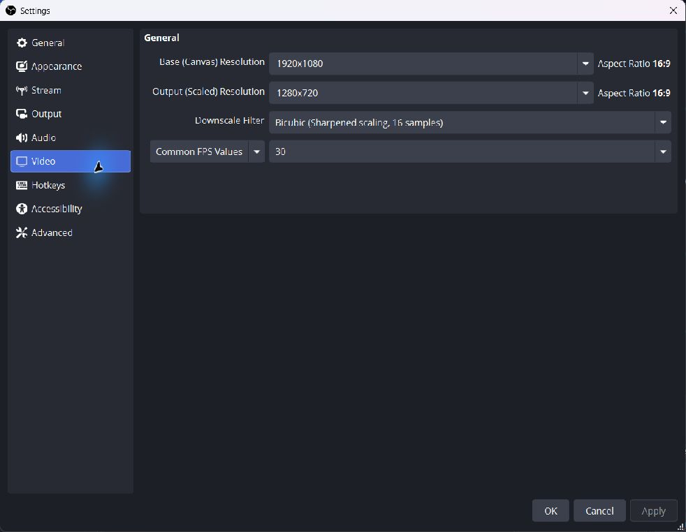
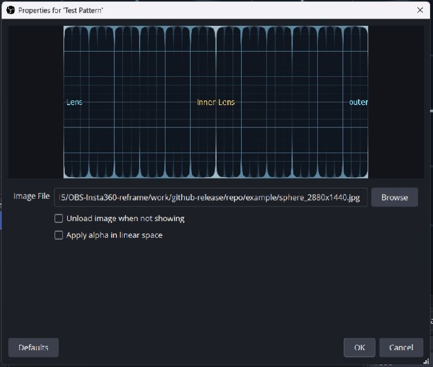
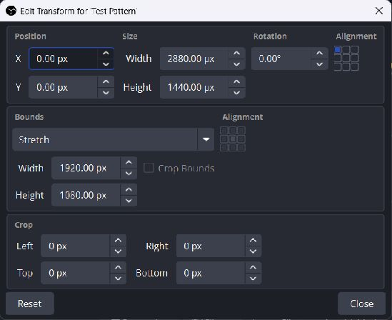
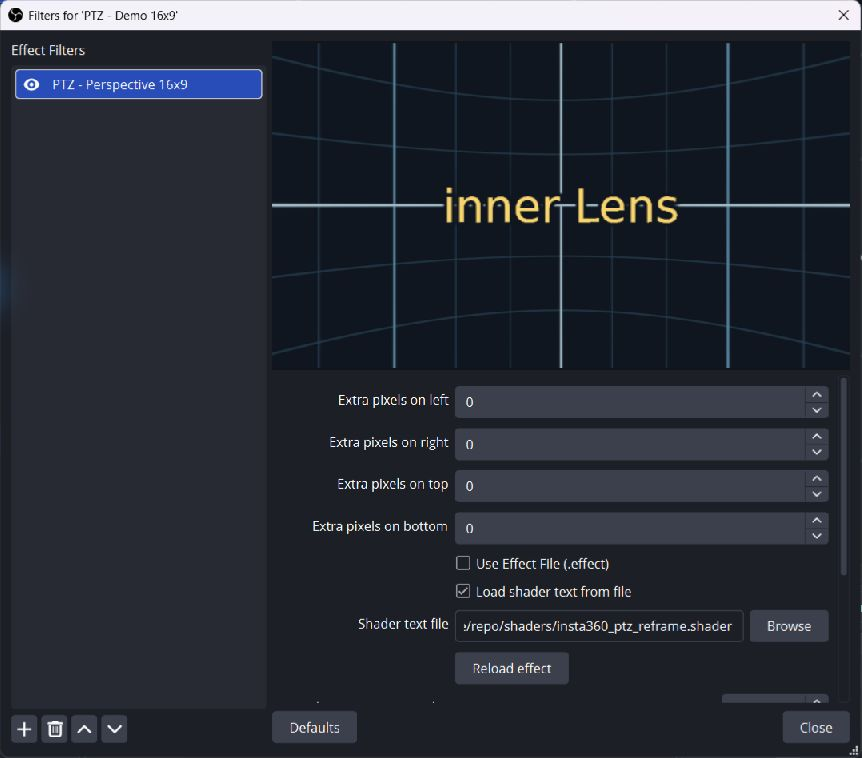
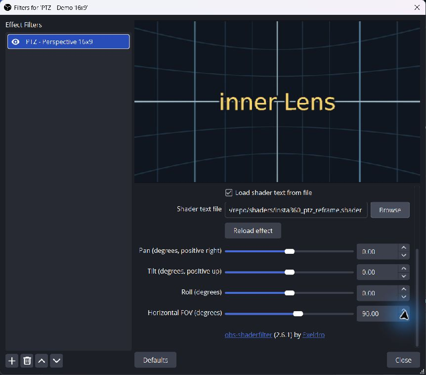
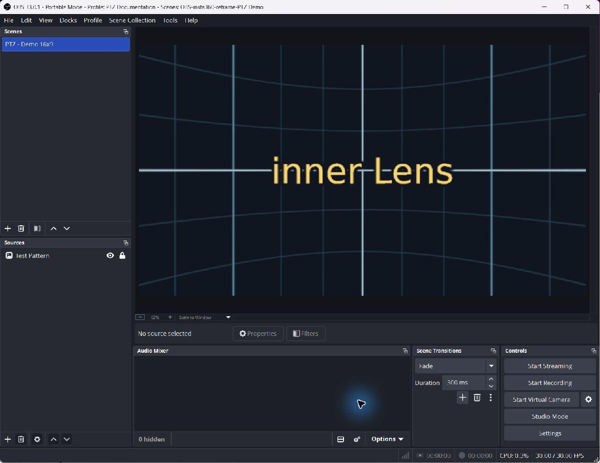
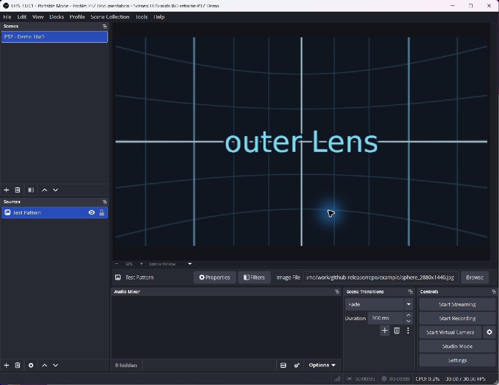

# OBS setup

This guide documents a **scene filter**. Do not apply a second copy of the shader to the input source.

## Canvas and output

In **Settings → Video**, set:

| Setting | Demonstrated value |
| --- | --- |
| Base (Canvas) Resolution | 1920×1080 |
| Output (Scaled) Resolution | 1280×720; 1920×1080 is also suitable |
| Common FPS Values | 30 |

The base canvas is the texture supplied to the scene filter. Output scaling happens later and does not recover panorama pixels lost before filtering. A different canvas size with the same 16:9 ratio is possible, but source transforms must be updated consistently. The import example assumes 1920×1080.

## Add and transform the test image

1. Create a scene named **PTZ - Demo 16x9**.
2. Add an **Image** source named **Test Pattern** and select `example/sphere_2880x1440.jpg`.
3. Select the source and choose **Transform → Stretch to Screen** (`Ctrl+S` on Windows).
4. Inspect **Transform → Edit Transform** (`Ctrl+E`). The bounds must be **Stretch to bounds**, **1920×1080**, position **0,0**, rotation **0°**, top-left positional alignment and zero crop on all four sides. This places the visible center at **960,540**. The Size fields may still display the original **2880×1440**: the bounding-box stretch determines the rendered size.
5. Lock the source after setup to prevent accidental moves.

**Fit to Screen is not equivalent.** It preserves the 2:1 input ratio and adds unused canvas space. For this scene-filter workflow, the *entire* panorama must cover the *entire* canvas without crop or letterboxing. The raw intermediate image is deliberately stretched; the shader interprets normalized coordinates and produces the final perspective image.

## Add the scene shader

Right-click the **scene in the Scenes list** → **Filters** → add **User-defined shader** under Effect Filters. Name it **PTZ - Perspective 16x9**.

| Setting | Value |
| --- | --- |
| Load shader text from file | Enabled |
| Shader file | `shaders/insta360_ptz_reframe.shader` |
| Use Effect File / override entire effect | **Disabled** |
| Extra pixels: left, right, top, bottom | **0** |
| Pan / Tilt / Roll | **0 / 0 / 0** |
| Horizontal FOV | **90** |

The shader file contains a `mainImage` function for shaderfilter's template, not a complete OBS effect. Enabling Effect File mode uses the wrong loader.

## Validate the two lens directions

With tilt=0, roll=0 and FOV=90:

- Pan **0°**: the yellow **inner Lens** label is centered.
- Pan **180°** or **−180°**: the cyan **outer Lens** label is centered, joining the two original image edges.

## Replace the pattern with an X4 or X5

Connect your **Insta360 X4 or X5** in **Webcam Mode**. Add an OBS **Video Capture Device**, choose the camera, set **Resolution/FPS Type** to **Custom**, and select **2880×1440**. This capture resolution activates the full 360° equirectangular output. Selecting **1920×1080** instead delivers reframed or split-screen video, which cannot supply the full sphere to this shader. These source capture settings are separate from the **1920×1080 OBS canvas**. The unfiltered input must show the complete stitched panorama, not two fisheye circles. See the [input mode table](installation.md#3-choose-an-input). Apply the **same complete-canvas stretch** to this scene item. Do not crop, offset, mirror or rotate it. Hide the test pattern and enable the camera; an opaque pattern above the camera will otherwise cover it. Keep the PTZ shader on the scene.

The inner lens is the lens on the display side, assumed to lie at the center of the unfiltered panorama. If a different camera/firmware uses another panorama orientation, establish its zero direction before using the lens labels as physical references. Camera availability and mode names depend on the driver; they are intentionally not baked into the example export.
