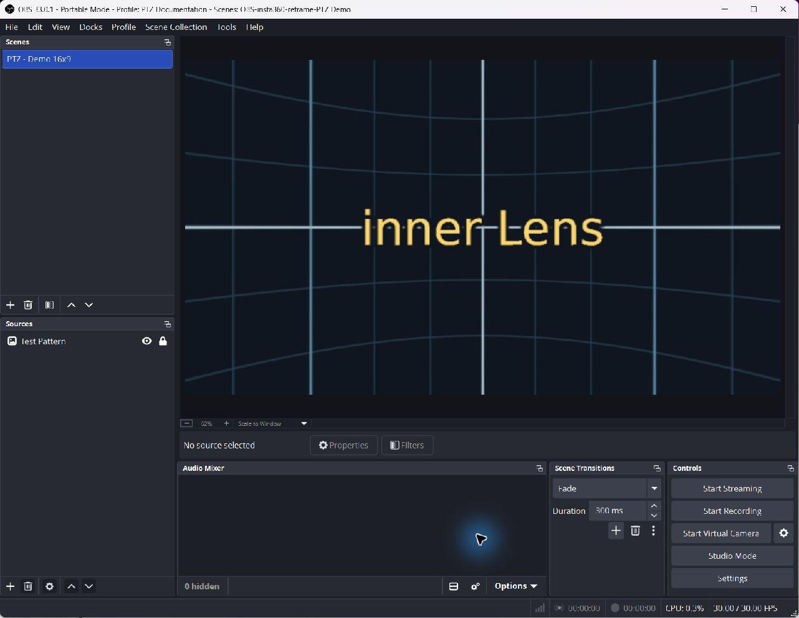

# Import the example scene collection

`example/obs-scene-collection.json` is a sanitized **template derived from the verified test-scene settings**. It contains one image source, one scene and the scene's shader filter. It deliberately excludes the live camera, audio devices, streaming configuration, browser credentials, personal hotkeys and unrelated scenes.

OBS exports scene **collections**, not self-contained bundles of every referenced file. The image and shader remain external files. The template uses `__REPO_ROOT__` instead of a personal absolute path; resolve it before import.

## Recommended Windows preparation

Run the included script from PowerShell, using its actual location:

```powershell
& 'C:\OBS-PTZ\tools\Prepare-SceneCollection.ps1'
```

The script reads the template, validates the required files and writes **`.local/obs-scene-collection.json`** with paths for the current repository location. It also prints the local dock URL. It does not edit OBS, connect to WebSocket, select devices or modify the template. `.local/` is excluded from Git because it contains machine-specific paths. If your execution policy blocks scripts, use the manual method below; changing Windows policy is not required.

## Manual preparation (any platform)

1. Copy `example/obs-scene-collection.json` to a separate local file.
2. Replace every `__REPO_ROOT__` with the repository's absolute directory, using forward slashes; for example `C:/OBS-PTZ`. Do not add a trailing slash.
3. Preserve valid JSON. The two resulting paths must identify the test JPG and `.shader` file.

## Import in OBS

1. First export/back up your own collection if desired. Do not import over a collection with the same example name.
2. Choose **Scene Collection → Import**, add the prepared JSON and import it.
3. Select **OBS-insta360-reframe-PTZ Demo** from **Scene Collection**.
4. Set the profile's **Base (Canvas) Resolution to 1920×1080** using [OBS setup](obs-setup.md). Profile/video/output settings are not provided by this collection.
5. If OBS reports missing files, browse to the test image. Independently open the scene filter and verify its shader path; shader paths may not participate in OBS's missing-media-file dialog.
6. Check both lens labels, then [add the dock](dock-setup.md).

The example image is locked to prevent accidental movement. To inspect its transform, temporarily unlock **Test Pattern** in Sources, open **Transform → Edit Transform**, and lock it again afterward.



The example does not install the plugin, create the browser dock, enable WebSocket or transfer browser-local presets. Those are separate steps. The dock seeds two neutral views only for the exact example collection/scene/filter when no saved views exist. You can also explicitly import `example/ptz-demo-presets.json`; import replaces the target's slots after confirmation.

## Moving or sharing the setup

After moving the repository, run preparation again and update existing OBS image/shader paths and the dock URL. Reimporting is unnecessary if you update paths in place. On another computer, select the camera device locally instead of copying someone else's device identifier.

References: [OBS scene collections](https://obsproject.com/kb/scene-collections), [OBS profiles](https://obsproject.com/kb/profiles).
