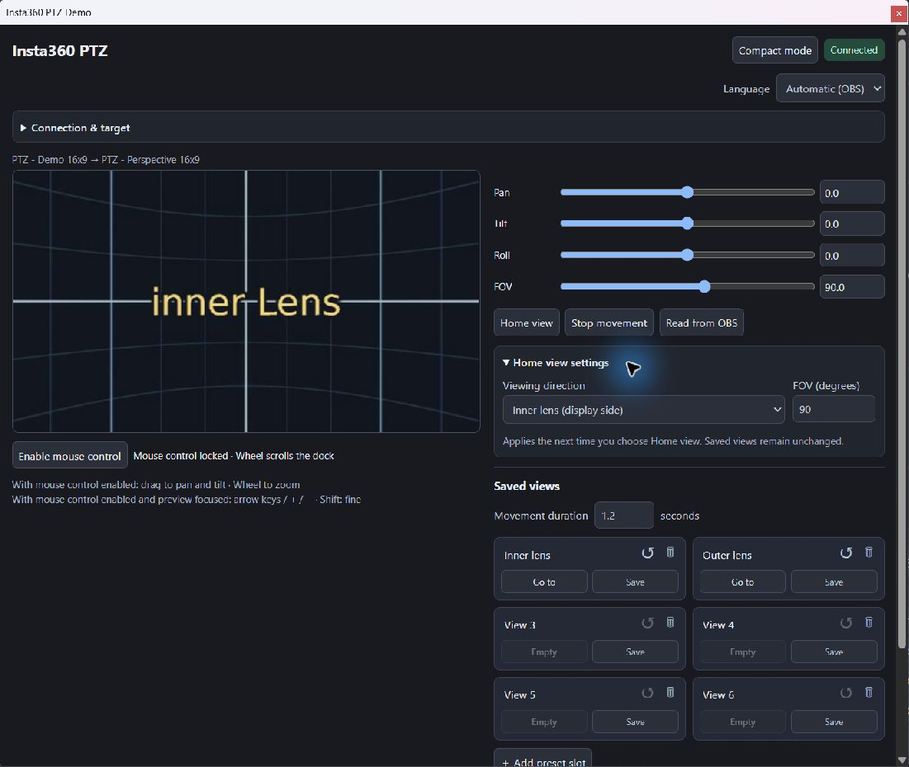
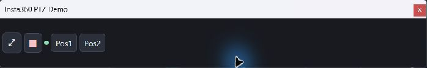
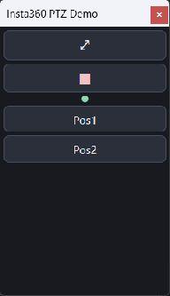

# Using the virtual PTZ camera

## View controls

The four values control the virtual view, not the physical camera:

| Parameter | Meaning | Range |
| --- | --- | --- |
| Pan | Horizontal direction; positive toward the panorama's right | −180…180° |
| Tilt | Positive upward | −90…90° |
| Roll | Rotation around the viewing axis before tilt/pan | −180…180° |
| FOV | **Horizontal** field of view; lower values zoom in | 10…150° |

Pan +180° and −180° are the same direction. A 90° horizontal FOV has an approximately 58.72° vertical FOV at 16:9. Large FOV values stretch objects near perspective-frame edges; that is expected rectilinear projection behavior.

## Mouse lock

Mouse control is **locked at startup, on reconnect and on a full/compact mode switch**. While locked, dragging and movement keys in the preview do not move the view, and the wheel scrolls the dock even over the preview. Sliders, numeric inputs, preset buttons and Home remain available.

Select **Enable mouse control** to allow:

- Left-button grab-and-drag in the preview to pan/tilt.
- Wheel up to zoom in and wheel down to zoom out.
- Arrow keys and `+`/`−` while the preview has focus.
- Shift for finer drag/wheel/arrow control.

Use **Lock mouse control** when finished. Escape in the preview or **Stop movement** stops a dock animation. A manual adjustment also interrupts it.

## Home view

Expand **Home view settings**, choose the **inner lens (display side)** or **outer lens**, and choose FOV 10–150°. Home uses pan=0° for inner and pan=180°/−180° for outer; tilt and roll are zero. Changing these settings only stores the choice. The next **Home view** click starts the move.

Home settings do not rotate or rebase existing presets: their saved PTZ directions remain absolute.

## Presets

Start with six slots; **＋ Add preset slot** adds empty slots, up to 100. Give a slot a name and press **Save**. Saving first reads the acknowledged values from OBS. Saving over a populated slot replaces its pose. **Recall** moves to the stored pose.

- **↺ Clear position** removes only the saved pose after confirmation; the slot and name remain.
- **Trash: Delete preset slot** removes the entire slot. A populated slot requires confirmation; an empty slot is removed directly.
- Other slots and the current camera view remain unchanged when clearing/deleting. Stable internal identifiers prevent an in-progress save from writing into a different slot after deletion.

**Move duration** applies to Home and presets. Zero jumps immediately; 1.2 seconds gives a smooth move. Pan and roll follow the shortest route across the ±180° seam.

Export regularly for backup. New JSON exports use version 2, including variable slots, IDs and optional home settings. Version 1 imports remain supported. Import replaces slots after confirmation and does not move the view. The demo export intentionally uses neutral views instead of personal positions.

## Compact mode

Select **Compact mode**. Only populated slots appear as **Pos1, Pos2, …**, keeping their full-panel slot numbers. Hover to see the full saved name. Empty slots are omitted, so gaps in numbering are expected.

The layout automatically follows the browser viewport: wider than tall (or square) is horizontal; taller than wide is vertical. Excess buttons scroll inside the strip, with wheel support for horizontal overflow. **⤢ Expand** restores the full controls; **■ Stop** stops a dock move. A green dot indicates a validated connection. Connection errors reopen the full controls.

The mode is stored locally and preview-image requests pause while compact. OBS controls the dock's outside size and placement: resize it or drag its title bar to dock it. **Expand does not restore a previous outer window size automatically.** Floating and docked windows may have different OBS minimum sizes. After a restart, expand and re-enter the WebSocket password if the saved compact mode starts disconnected.

## Move plugin coexistence

Move is optional. A Move Value filter can target the scene's shader filter and animate `pan`, `tilt`, `roll` and `fov`. Moving/scaling the input scene item with Move Source is a different operation and can destroy the panorama-to-canvas mapping.

Avoid simultaneous dock and Move animations of the same parameters. The dock periodically reads external settings while idle, but its Stop button does **not** stop a separate Move-plugin animation. Stop that animation through its own controls first. The example collection contains no Move filters or hotkeys.

## Preview and output

The dock requests a 640×360 JPEG preview approximately every 180 ms while expanded. PTZ writes are coalesced at up to 25 requests/s. This is a control preview; OBS renders the actual output at its configured frame rate. Neither connecting nor changing UI mode starts a stream, recording or virtual camera.
